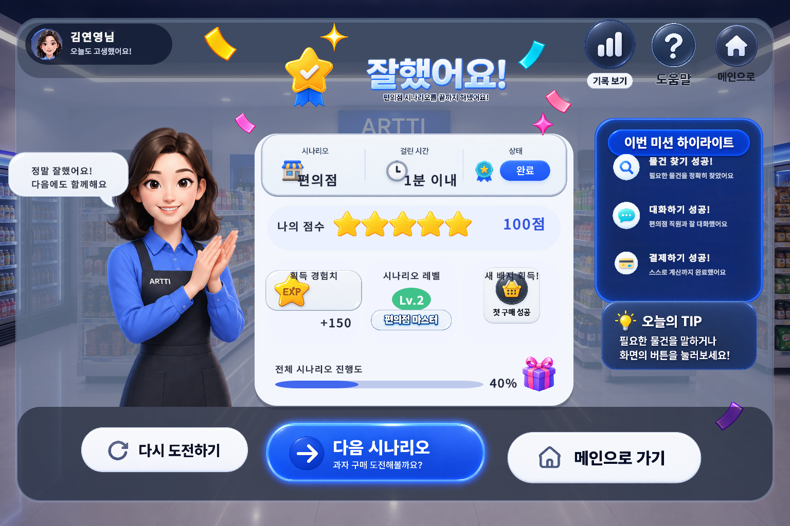
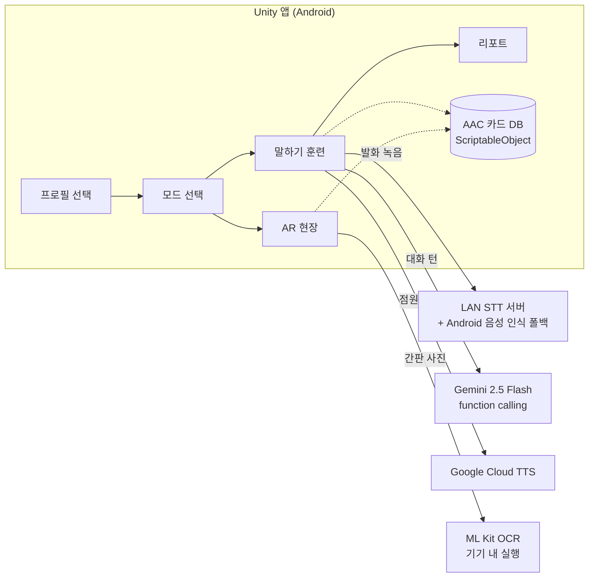

<div align="center">

# 아르띠 (Artti)

**발달장애인이 편의점·약국·음식점에서 스스로 말할 수 있도록 돕는 AI · AAC 소통 훈련 앱**




</div>

---

## 프로젝트 소개

발달장애인은 물건을 사거나 약을 사는 짧은 대화에서도 말을 꺼내기 어려워 지역사회 참여가 제한됩니다.
특수학교 교사·복지관 담당자 인터뷰에서 **"실제 상황과 비슷한 반복 연습"** 과 **"현장에서 바로 쓸 수 있는 보조 수단"** 이 가장 필요하다는 의견을 듣고, 하나의 앱에 두 가지 모드를 넣었습니다.

| | 말하기 훈련 모드 | AR 현장 모드 |
|---|---|---|
| 대상 | 말할 수 있지만 연습이 필요한 이용자 | 말하기가 어려운 이용자 |
| 장면 | 3D 편의점에서 점원 NPC와 대화 | 실제 가게 앞에서 카메라로 촬영 |
| 동작 | 말하기 → 음성 인식 → AI 점원 응답 | 간판 인식 → 장소에 맞는 AAC 카드 → 음성으로 대신 말하기 |
| AI | Gemini function calling 대화 매니저 | ML Kit OCR(기기 안에서 실행) |

- **기간**: 2026.05 ~ 진행 중
- **팀**: 3인 (한국폴리텍대학 컴퓨터공학과 · 디지털융합제어과)
- **대상 기기**: Android 태블릿 가로 모드 (Galaxy Tab S7 FE에서 테스트)

## 주요 기능

### 1. 말하기 훈련 (편의점 시나리오)
- **3D 점원 NPC**와 인사 → 물건 고르기 → 추가 요청 → 계산 → 인사까지 실제 순서대로 대화합니다.
- **정확도 모드**: 화면의 추천 문장을 따라 말하면 발음 명료도(%)를 재고, 기준을 넘어야 다음 단계로 넘어갑니다.
- **대화 모드**: 정해진 문장이 아니어도 AI가 뜻을 알아듣고 대화를 이어 갑니다. 어눌한 발음도 의도를 추정합니다.
- 막히면 힌트를 단계적으로 늘려 주고(0 → 1 → 2단계), 4번 실패하면 부드럽게 마무리합니다.

### 2. AR 현장 모드
- 가게 간판을 찍으면 **ML Kit OCR**로 글자를 읽고 키워드 사전으로 장소 종류를 맞힙니다.
- 그 장소에서 쓸 AAC 카드를 단계별로 보여 주고, 카드를 누르면 **TTS가 대신 말해 줍니다.**

### 3. 연습 리포트
- 세션마다 단계별 발화 정확도와 그 이유, 완료율 도넛 차트, 경험치·레벨을 보여 줍니다.
- Gemini가 기록을 보고 이용자에게 맞는 응원 문구를 만들어 줍니다.

### 4. 다중 프로필
- 한 태블릿을 여러 학생이 쓰는 교실 환경을 고려해 로컬 프로필을 여러 개 만들고, 프로필마다 말 빠르기·읽어 주는 목소리를 따로 저장합니다.

## 시스템 구조



## 기술 스택

| 분류 | 사용 기술 |
|---|---|
| 엔진 / 플랫폼 | Unity 6000.3 (6.3 LTS), URP 17.3, Android (Min SDK 30, ARM64, IL2CPP) |
| UI | uGUI 2.0 + TextMeshPro |
| AR | AR Foundation 6.3 + ARCore |
| AI 대화 | Google Gemini 2.5 Flash (function calling, 도구 8종) |
| 음성 | LAN STT 서버(Whisper 계열) + Android SpeechRecognizer, Google Cloud TTS, uLipSync(립싱크) |
| OCR | Google ML Kit Text Recognition (Android AAR 브리지) |
| 비동기 / 데이터 | UniTask, Newtonsoft.Json, JSONL 로그 |
| 3D 제작 | Meshy, Blender |
| 테스트 | Unity Test Framework (EditMode) |
| 협업 | GitHub PR, Notion, Discord, Claude Code + mcp-unity |

## 기술적으로 고민한 점

**1. LLM이 대화 순서를 망치지 않게 하기**
Gemini가 다음 단계를 제안해도 그대로 믿지 않습니다. 없는 단계(환각)는 무시하고, 이미 지난 단계로 돌아가는 것은 거부하고, 여러 단계를 건너뛰면 바로 다음 단계로 제한합니다. `tool_config.mode = ANY`로 항상 도구를 호출하게 해 응답 형식이 흔들리지 않게 했습니다.

**2. 규칙 기반 + LLM 혼합으로 응답 속도 확보**
정해진 문장 버튼과 상품 선택은 앱이 규칙으로 바로 처리하고, 규칙에 없는 발화만 LLM에 보냅니다. 자주 쓰는 흐름은 네트워크를 기다리지 않습니다.

**3. 음성 인식이 끊겨도 훈련이 멈추지 않게**
LAN STT 서버(명료도 측정 포함)를 먼저 쓰고, 연결이 안 되면 Android 기본 음성 인식으로 자동 전환합니다. `ISttService` / `ITtsService` 인터페이스로 구현을 감싸 에디터에서는 가짜 구현으로 테스트합니다.

**4. 저사양 태블릿에서 앱이 재시작되는 문제**
외부 카메라 앱으로 사진을 찍는 동안 메모리가 부족한 기기에서 앱이 백그라운드에서 종료되었습니다. 앱 안에서 카메라를 직접 열고(WebCamTexture), ARCore가 잡고 있던 카메라를 촬영 직전에 넘겨받는 방식으로 바꿔 해결했습니다.

**5. 여러 명이 같은 씬을 고칠 때의 충돌**
Unity 씬 파일 충돌을 줄이려고 씬을 C# 코드(씬 빌더)로 다시 만들 수 있게 하고, 손으로 배치한 값은 빌더로 옮겨 재현 가능하게 했습니다.

## 팀 구성과 역할

| 이름 | 역할 |
|---|---|
| 김연영 (팀장) | 기획 총괄, AAC 데이터 |
| 방승훈 | UI · 시각 리소스, AR 현장 모드 OCR |
| 오정훈 | 말하기 훈련 모드 · 대화 매니저 · 음성 · 리포트 |

**오정훈 담당 상세**
- Gemini function calling 대화 매니저와 대화 상태 머신, 힌트 단계 정책
- STT/TTS 서비스 계층(서버 STT, Android 네이티브 폴백, 명료도 관문)
- 연습 기록 로그와 리포트·세션 상세 화면, AI 응원 문구
- 프로필 생성·선택·설정 흐름, 태블릿 화면비 대응

## 프로젝트 구조

```
Assets/_Project/
├── _Scripts/
│   ├── Training/      # 대화 매니저, Gemini 호출, 힌트 정책, 점원 NPC
│   ├── Common/Speech/ # STT·TTS 인터페이스와 구현(서버·네이티브·클라우드)
│   ├── ARField/       # AR 현장 모드 흐름
│   ├── OCR/           # ML Kit OCR 브리지, 키워드 매칭, 인앱 카메라
│   ├── AAC/           # AAC 카드 데이터, 시나리오 목표, 이벤트 로그
│   ├── Report/        # 리포트 집계, AI 평가·응원 문구
│   └── UI/            # 화면별 뷰
├── Editor/            # 씬 빌더, 빌드 설정, EditMode 테스트
└── Scenes/            # Splash → Profile → Main → Training / ARField → Report
docs/                  # 기획서, 화면정의서, 기술 정리
```

## 실행 방법

1. Unity **6000.3.14f1**로 프로젝트를 엽니다.
2. 루트의 `.env.example`을 복사해 `.env`를 만들고 키를 채웁니다.
   (`GEMINI_API_KEY`, `GOOGLE_TTS_API_KEY`, `STT_SERVER_URL` 등)
   빌드할 때 `.env`가 자동으로 `Assets/Resources/api_keys.txt`로 복사되며, 이 파일은 git에 올라가지 않습니다.
3. 메뉴 `Artti ▸ Apply Android Player Settings`로 Android 설정을 적용합니다.
4. `Assets/_Project/Scenes/SplashScene.unity`부터 실행하거나 Android로 빌드합니다.

## 문서

| 문서 | 내용 |
|---|---|
| [docs/PLAN.md](docs/PLAN.md) | 개발 기획서 (배경, 인터뷰, 설계, 일정) |
| [docs/TECH_NOTES.md](docs/TECH_NOTES.md) | 씬별 기술 정리, 문제 → 원인 → 해결 기록 |
| [docs/Artti_화면정의서_v3.3_260608.md](docs/Artti_화면정의서_v3.3_260608.md) | 화면 정의서 |

<details>
<summary><b>개발 메모: 한글이 네모(□)로 보일 때</b></summary>

TextMeshPro 폴백 설정이나 폰트 에셋의 글리프 테이블이 비면 한글이 전부 네모로 보입니다.

- 해결: `Window ▸ TextMeshPro ▸ Import TMP Essential Resources` 또는 `git restore "Assets/Fonts/"`
- 주의: 폰트 에셋의 Clear Dynamic Data / Reset, 폰트 베이커 일괄 실행은 글리프를 지워 상황을 악화시킵니다.

</details>
